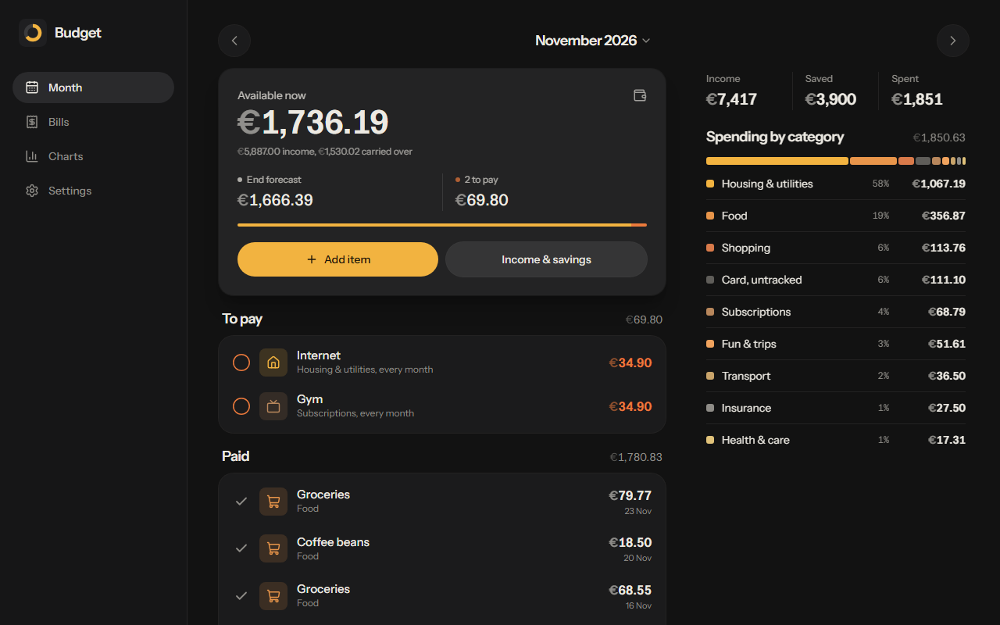
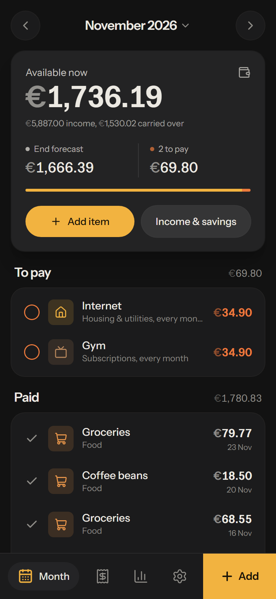
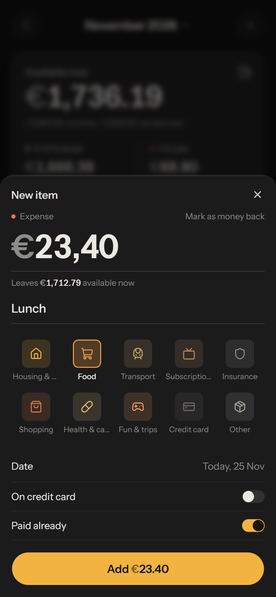
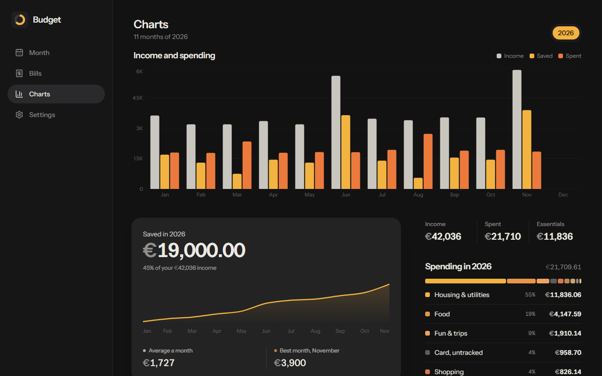
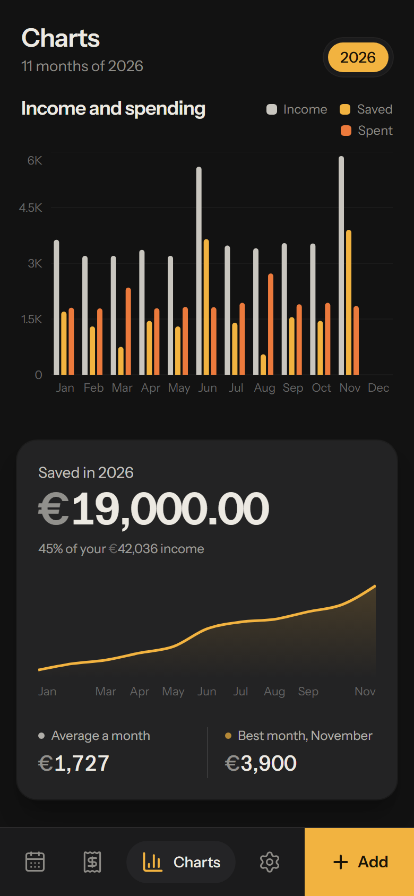
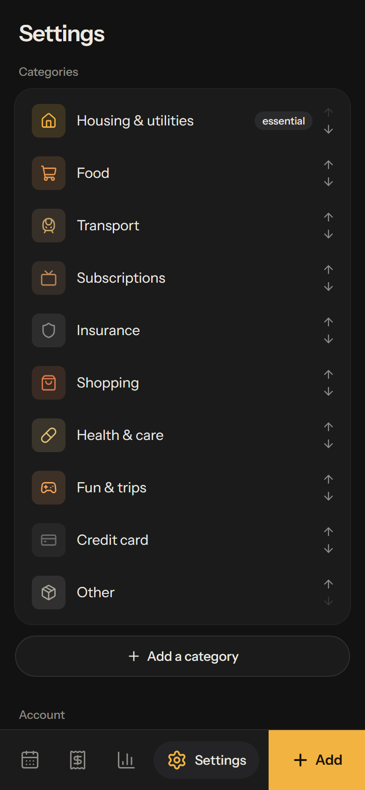

# Budget

A private, single-user budget tracker. It's built mobile-first for logging payments in a few taps, with a desktop view for charts and yearly totals.

Built with **Next.js 16**, **Supabase** (Postgres + Auth), **Tailwind CSS 4**, **shadcn/ui** and **Recharts**.



<sub>All screenshots use made-up demo data (see [Demo data](#demo-data)).</sub>

## Features

### Month at a glance

Each month opens with two numbers:

- **Available now:** what's actually in the account today, meaning income plus last month's carry-over, minus savings and everything already paid.
- **End forecast:** what will be left once every unpaid item is paid as well.

Below them are the items still **to pay**, marked with an orange ring, and the ones already **paid**, marked with a quiet tick. Tap the ring when the money leaves your account. Beside the list (or below it on a phone) are the month's income, savings and spending, plus a breakdown of spending by category. Whatever is left at the end of a month carries over into the next one automatically.

Tap the month name at the top to jump to any other month. Months that have items are marked with a dot.



### Quick add

The **Add** button opens a sheet built for adding a payment in a few taps. Type the amount (the phone shows its number keyboard), name it, pick a category, and you're done. Recent names show up as chips that fill in the amount and category for you. You can pick any date or mark the payment as not paid yet. For a refund, tap **Mark as money back**: it's shown in green instead of with a minus sign.



### Credit card

Turn on **On credit card** and the purchase goes into the card bill that pays for it. That's next month's bill, because the statement closes on the first workday of the month and is collected on the 10th. The card bill shows what you've itemised, and any difference from the statement is shown as **Card, untracked**, so the categories still add up.

### Regular bills

Rent, utilities, subscriptions and insurance are set up once on the **Bills** page. Each new month starts with them as unpaid items. If you edit a bill, the change is also applied to its unpaid entries from the current month on. Pause a bill to stop adding it to new months.

### Income and savings

Each month has its own income lines: a recurring salary plus one-off extras such as a bonus or freelance work. It also has a savings amount, which is set aside before anything else is counted as available.

### Charts

Per year you get:

- income, savings and spending for each month
- your savings building up over the year, with the monthly average and the best month
- yearly totals, including **Essentials** (spending in categories marked essential)
- spending per month, split by category (money back isn't counted here, so a refund never hides what you spent)
- spending by category for the whole year





### Categories

Rename, recolour and re-icon categories in **Settings**. Mark the essential ones there, and archive any you no longer use. Archived categories stay in your history.



### Mobile first

It's designed for a phone: a bottom bar with a wide **Add** button in the corner, sheets that open from the bottom edge, large touch targets, and safe-area padding for devices with a notch. On a wider screen it switches to a sidebar with two columns.

### Private by design

You log in with an email and password, and nobody can sign up. Every table is protected by row-level security (see [Security](#security)).

## Getting started

### Prerequisites

- Node.js 24+ and pnpm
- Docker (for the local Supabase stack)

### Setup

```bash
pnpm install
pnpm exec supabase start      # local Postgres + Auth
pnpm exec supabase db reset   # apply migrations and seed data
```

Create `.env.local` using the values printed by `pnpm exec supabase status`:

```env
NEXT_PUBLIC_SUPABASE_URL=http://127.0.0.1:54321
NEXT_PUBLIC_SUPABASE_PUBLISHABLE_KEY=<PUBLISHABLE_KEY>
```

### Run

```bash
pnpm dev        # http://localhost:3000
pnpm dev:lan    # also reachable from a phone on the same network
```

The seed creates one user, `test@email.com` / `123456`, along with default categories and regular bills. Sign-ups are disabled.

### Demo data

To try the app with a year of made-up data, load the demo account. You can run it again at any time to reset the account, and other users' data isn't touched:

```bash
docker exec -i supabase_db_budget-next-supabase psql -U postgres -d postgres < scripts/demo-data.sql
```

Then log in as `demo@example.com` / `demo-password`.

## Scripts

| Command | Description |
| --- | --- |
| `pnpm dev` / `pnpm dev:lan` | Development server |
| `pnpm build` / `pnpm start` | Production build and server |
| `pnpm test` | Unit tests (Vitest) |
| `pnpm lint` | ESLint |
| `pnpm db:types` | Regenerate database types after a schema change |

## Project structure

```
app/              Routes: login, month, bills, charts, settings
components/       UI by feature, plus shadcn primitives in ui/
lib/domain/       Pure money logic: totals, carry-over, billing cycle (unit-tested)
lib/dal/          Server-only data access; every read checks the session
lib/actions/      Server Actions for all changes
supabase/         Migrations, seed and local config
scripts/          Spreadsheet import and demo data
docs/             Import guide and screenshots
```

## Security

- Every route except `/login` redirects to the login page when there's no session (`proxy.ts`).
- Every page and Server Action re-checks the session on the server before touching data.
- Row-level security limits every table to its owner, and anonymous access is revoked.
- Sign-ups are disabled in `supabase/config.toml`.

## Deployment

The app currently runs locally only. To put it online:

1. Create a Supabase project and push the migrations (`supabase db push`).
2. Disable sign-ups and create your user with a **strong password**.
3. Deploy to Vercel, setting `NEXT_PUBLIC_SUPABASE_URL` and `NEXT_PUBLIC_SUPABASE_PUBLISHABLE_KEY`.
